<p align="center">
  <picture>
    <source media="(prefers-color-scheme: dark)" srcset=".github/readme/banner-dark.png">
    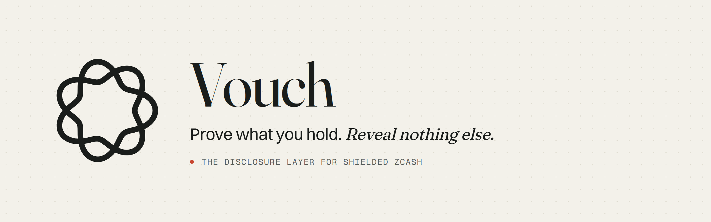
  </picture>
</p>

<p align="center">
  <a href="https://github.com/SATISH-JALAN/Vouch/actions/workflows/ci.yml"></a>
  <a href="https://github.com/SATISH-JALAN/Vouch/releases/latest"></a>
  
  
  
  
</p>

<p align="center">
  <a href="https://vouch-zcash.vercel.app"><b>Live site</b></a> ·
  <a href="https://vouch-zcash.vercel.app/docs"><b>Documentation</b></a> ·
  <a href="https://vouch-zcash.vercel.app/verify">Verify a real proof</a> ·
  <a href="https://vouch-zcash.vercel.app/demo">Devnet demo</a> ·
  <a href="https://github.com/SATISH-JALAN/Vouch/releases/latest">CLIs</a>
</p>

<p align="center">
  
</p>

**Vouch is the disclosure layer for shielded Zcash.** Instead of handing over a viewing key, a holder proves one fact about their coins, to one party, and reveals nothing else:

- **Exit certificates:** *“at least X ZEC, in notes that were already in the chain at block H and haven’t moved since, and these are the notes I’m sending you.”* The rail picks H, checks the certificate in about 100 ms, and matches it to the deposit when it lands.
- **Proof of funds:** *“at least X ZEC”*, to one named verifier, until one expiry, revocable. If the same coins are pledged to that verifier twice in a period, it sees it. Nobody else can link anything.
- **Reserves:** several proofs summed with no note counted twice, published as a Solana feed that a token can only mint within.

The proof is a 12 KB `.pof` file, a zero-knowledge proof over the Zcash chain’s own data. Anyone can check it against public roots in a browser, with a CLI, or through an attestor. Nothing is bridged and nothing is locked; only a proof moves.

Colosseum **Crypto World’s Fair 2026**, Zcash track. A hackathon build: **not audited, testnet only**. The [honest list](#what-is-not-done) of what isn’t done is below.

---

## Contents

[Why it exists](#why-it-exists) · [How it works](#how-it-works) · [Why only Zcash](#why-this-only-works-on-zcash) · [The three products](#the-three-products) · [Proof it works](#proof-it-works) · [What is deployed](#what-is-deployed) · [Architecture](#architecture) · [Performance](#performance) · [Running it](#running-it) · [Tests](#tests) · [Repo layout](#repo-layout) · [Trust model](#trust-model) · [What is not done](#what-is-not-done) · [Design choices](#design-choices-worth-one-line-each) · [Credits](#credits-and-licence)

## Why it exists

Shielded ZEC is private until it has to leave. At a swap rail, an exchange or an OTC desk, screeners can’t score shielded coins: there is no address history to look at. A large shielded deposit therefore lands as “unknown”, and unknown deposits get held.

Today the only thing a holder can offer to get one released is a **viewing key**. That is the wrong tool for the job:

| | A viewing key | A Vouch proof |
| --- | --- | --- |
| Shows | Every note, amount and memo the wallet has ever received | One claim: “at least X” |
| For | Whoever holds the key | One named verifier, by the hash of its identifier |
| Lasts | For ever, including future payments | Until one expiry |
| Revocable | No | Yes: publish a secret |
| Scoped | No | Yes: one verifier, one period |
| Proves the holder can spend | No: viewing keys can’t spend | Yes: signed with spend authority |
| Checkable by | Someone who scans the chain with it | Anyone, in ~100 ms, from public data |

Lenders and treasuries have the same problem from the other side. A lender can’t lend against collateral it can’t see. A treasury holding shielded ZEC can’t show its reserves without showing its wallet. Vouch is the third option between “show everything” and “show nothing”: show one fact.

## How it works

<picture>
  <source media="(prefers-color-scheme: dark)" srcset=".github/readme/fig-lifecycle-dark.png">
  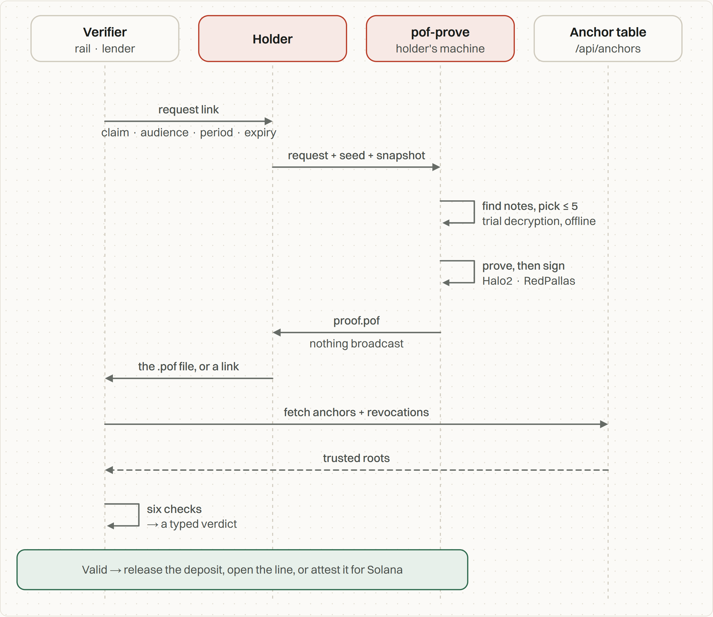
</picture>

1. **The verifier asks.** A request is a link carrying the threshold, the verifier’s identifier, an expiry, and optionally a period and an “unmoved since” block. Nothing is stored on a server.
2. **The holder proves, offline.** `pof-prove` reads the request, a public chain snapshot and the holder’s seed. It trial-decrypts the holder’s Ironwood notes, picks up to five, builds a Halo2 proof and signs the statement with the notes’ spend authority. The prover library links no network client, and a test enforces it.
3. **Anyone verifies.** `pof-verify` runs six checks, cheapest first: format, expiry, revocation, audience and period, anchors and policy, then the proof itself. It returns a typed verdict. The same Rust code runs as a CLI, as WASM in the browser, and inside the attestor.
4. **Someone acts.** A rail releases a deposit, a lender opens a line, or an attestor signs the verdict for a Solana program.

<picture>
  <source media="(prefers-color-scheme: dark)" srcset=".github/readme/fig-pipeline-dark.png">
  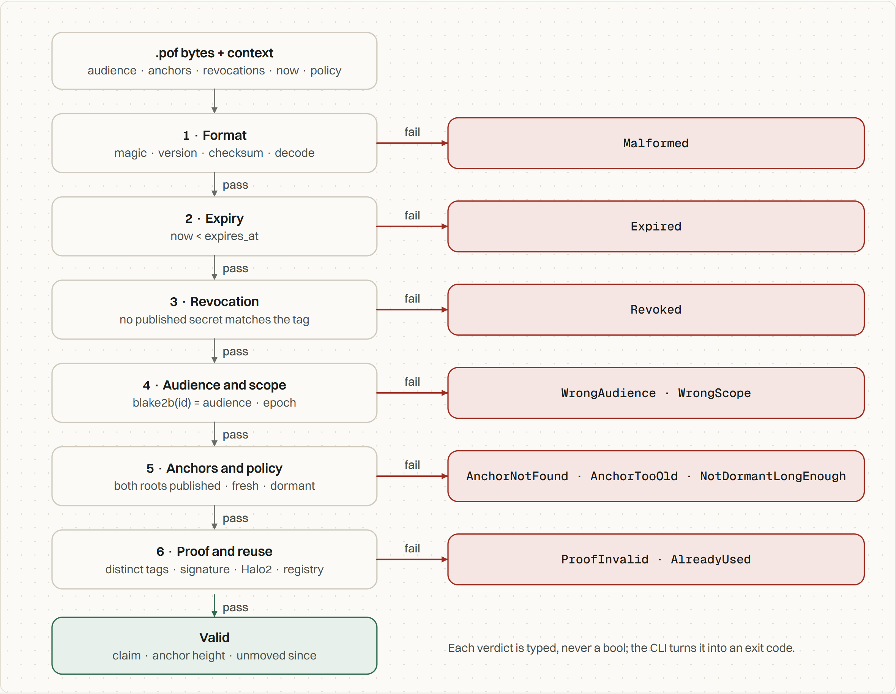
</picture>

### “Unmoved since block H”

The proof takes the note-commitment tree at one block and the spent-nullifier set at a later one. A note that was already a leaf at H₀, and whose nullifier is still absent at H₁, existed then and hasn’t moved since. Both roots were already independent public inputs, so this needed no circuit change, only a verifier rule.

<picture>
  <source media="(prefers-color-scheme: dark)" srcset=".github/readme/fig-dormancy-dark.png">
  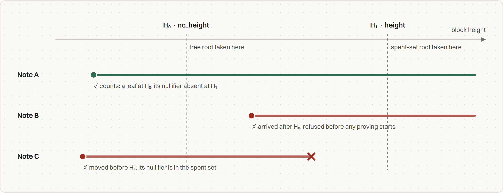
</picture>

## Why this only works on Zcash

- **The note-commitment tree is a clock.** It only grows, so “this note was a leaf at block H” is a permanent, public fact about the past.
- **The nullifier set is a “not moved” proof.** A note can only be spent by revealing its nullifier.
- **Spend authority can be shown without spending.** A viewing key alone cannot make a proof.
- **The circuit already exists, and the community has used it.** Vouch uses the Ironwood delegation circuit from Valar Group’s [voting-circuits](https://github.com/valargroup/voting-circuits), the one the NU7 poll used, with one added constraint for “at least X”.

No association-set provider decides which coins are acceptable. The chain’s own history is the allow-list, and the verifier picks the block.

## The three products

<table>
<tr>
<td width="50%" valign="top">

### Exit certificates

For swap rails, exchanges and desks. The certificate is made with a second circuit that also reveals the certified notes’ nullifiers. When the deposit lands, the rail reads the nullifiers it reveals and checks every one was certified.

The real testnet deposit `ff0a2488…` → **Matched**.

</td>
<td width="50%">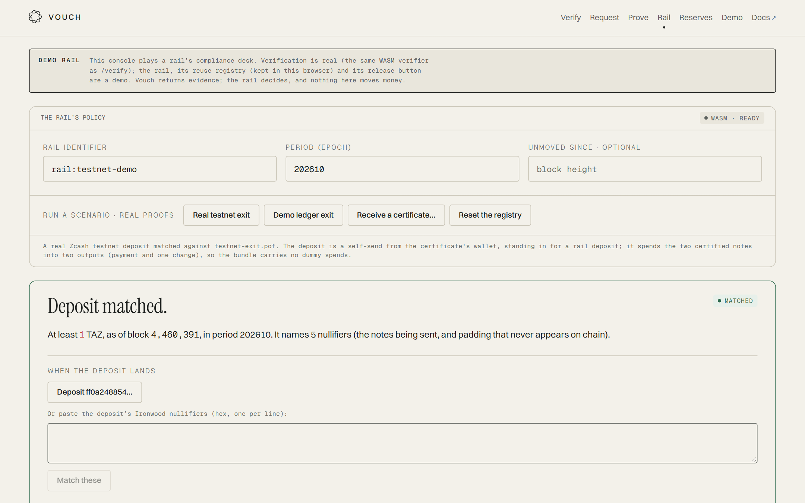</td>
</tr>
<tr>
<td width="50%">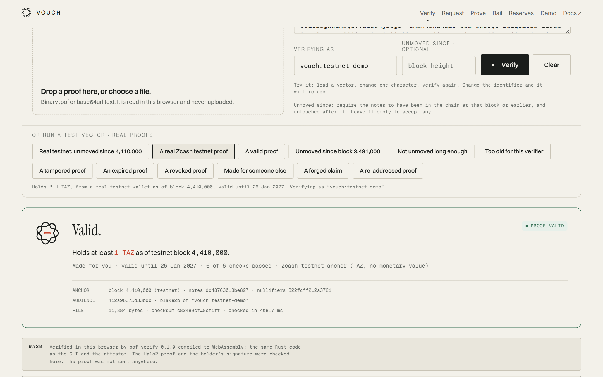</td>
<td width="50%" valign="top">

### Proof of funds

For lenders and counterparties. “At least X”, made for one verifier and one period. Scope tags make reuse visible to that verifier and unlinkable for everyone else. Revocable by publishing a secret.

A real testnet proof (≥ 1 TAZ at block 4,410,000), verified in the browser. The proof never leaves the tab.

</td>
</tr>
<tr>
<td width="50%" valign="top">

### Reserves

For treasuries and wrapped-ZEC issuers. A `.pofb` batch sums several proofs; a note counted in two of them is refused. An attestor signs the total, `pof-reserve` stores it as a feed, and its token mints only within the proven reserves, and only while the feed is fresh.

Demo batch: **4,018.125 ZEC across 3 proofs**, published on devnet.

</td>
<td width="50%">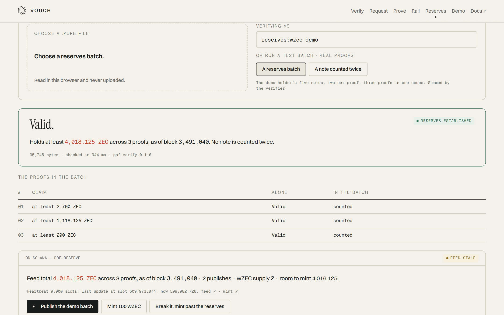</td>
</tr>
</table>

<picture>
  <source media="(prefers-color-scheme: dark)" srcset=".github/readme/fig-exit-dark.png">
  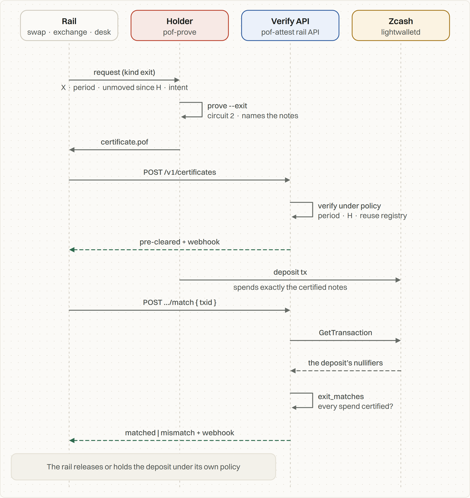
</picture>

<picture>
  <source media="(prefers-color-scheme: dark)" srcset=".github/readme/fig-match-dark.png">
  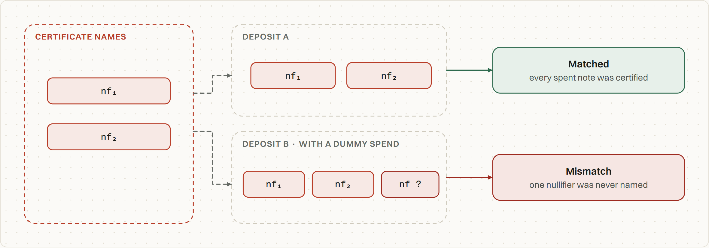
</picture>

## Proof it works

Everything below is real and reproducible. The Zcash artefacts are on **testnet**; there are no mainnet proofs.

**On Zcash testnet**

| What | Artefact | Result |
| --- | --- | --- |
| First real proof from a real wallet | `fixtures/proofs/testnet-valid.pof`: ≥ 1 TAZ at block 4,410,000 | `Valid`, natively and in WASM |
| “Unmoved since” | `fixtures/proofs/testnet-dormant.pof`: in the chain at 4,410,000, unspent at 4,459,000 | `Valid · unmoved since block 4410000` |
| A note that arrived too late | `testnet-dormant-too-young` | `NotDormantLongEnough` |
| Exit certificate | `fixtures/proofs/testnet-exit.pof`, anchor 4,460,391 | `Valid`, names its notes |
| The deposit | `ff0a2488543a58b852b22c426313ea00c00de1e79a6fa1710dc3cbae69ab256a`, spending exactly the certified notes | **`Matched`** |
| The first attempt | `testnet-exit-first-attempt`: the wallet added three dummy spends | `Mismatch`, kept as a documented finding |

**On Solana devnet**: the live end-to-end test (`scripts/e2e.mjs`) passed **26 of 26 checks** against https://vouch-zcash.vercel.app on 11 October 2026:

| Check | Evidence |
| --- | --- |
| Proof → attestation → receipt → 25,000 dUSDC line → 1,000 dUSDC draw; the borrower’s SOL untouched | receipt [`EaUp1ymf…NXVxY`](https://explorer.solana.com/address/EaUp1ymfiUyZWSL7H2aYfbsJZuHq1eyYBrBMYhKVXNxY?cluster=devnet) |
| Replay, a stranger’s wallet, a tampered attestation, a tampered proof, a revoked proof | each refused, at the instruction that should refuse it |
| A reserves batch published to the feed | [`3ZmwXQXM…woYmwnr`](https://explorer.solana.com/tx/3ZmwXQXMTdjQ55LAijzy4c4BmjhU1uKsZcHRQX2J5sb6A8nrxLDMRAU3r8g1m2RC6CeGvcwPzwqTkjmE3woYmwnr?cluster=devnet): 401,812,500,000 zat, 3 members, fresh |
| A double-counted batch | refused by the attestor |
| Secure Mint within the reserves; a mint past them | minted 1 wZEC; then `minting this would exceed the proven reserves` |

<p align="center">
  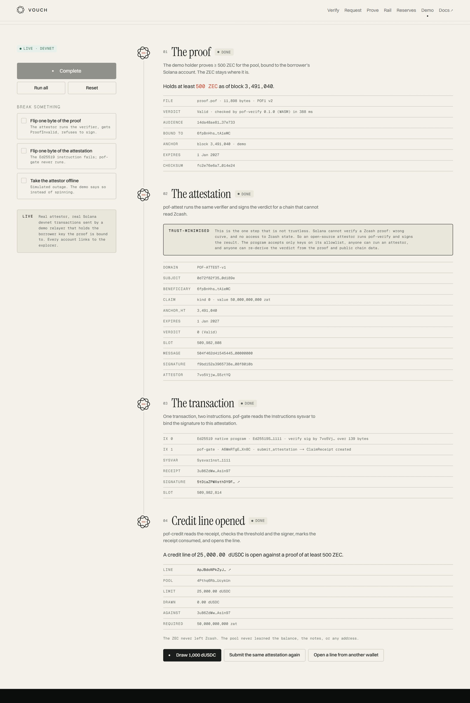
</p>

## What is deployed

| Thing | Where |
| --- | --- |
| Site, verifier, docs | https://vouch-zcash.vercel.app (Vercel) |
| Attestor | https://vouch-attest.onrender.com (Render, free plan), public key `7vo5Vjjwh3T4dcFBNhGVDJVFYmd9tvV3hnYX5pS5ztYQ` |
| `pof-gate` | [`A6WmRTgEAHC9GHstaj9oD8woVNRw9jgu31bpKVREXn8C`](https://explorer.solana.com/address/A6WmRTgEAHC9GHstaj9oD8woVNRw9jgu31bpKVREXn8C?cluster=devnet) (devnet) |
| `pof-credit` | [`J6ewFZAzcTkbVsYNBrcZvzdBtTTUK5UrpqCg9jiNyra1`](https://explorer.solana.com/address/J6ewFZAzcTkbVsYNBrcZvzdBtTTUK5UrpqCg9jiNyra1?cluster=devnet) (devnet) |
| `pof-reserve` | [`5Q26Tjcd4equ5te5hF15eG4xK6uvkbZtKkEeqdf535h9`](https://explorer.solana.com/address/5Q26Tjcd4equ5te5hF15eG4xK6uvkbZtKkEeqdf535h9?cluster=devnet) (devnet) |
| Credit pool / reserves feed / wZEC mint | [`4Pthq6Rb…ykUn`](https://explorer.solana.com/address/4Pthq6Rb9byV6196P2iNCiVchzaXGAgWy6XYfyUcykUn?cluster=devnet) · [`DssJrn97…aNV2`](https://explorer.solana.com/address/DssJrn97TNEmAcV6LYQrodCe1EDwN8qrkrSz4micaNV2?cluster=devnet) · [`b8N1r7GD…RUNQ`](https://explorer.solana.com/address/b8N1r7GDopnuRW4FdZ6wiPiemH5oe4fHrXpEM2gRUNQ?cluster=devnet) |
| Anchors | mainnet 3,493,000 · testnet 4,410,000, 4,459,000, 4,460,391 · demo 3,481,000, 3,491,040 ([`/api/anchors`](https://vouch-zcash.vercel.app/api/anchors)) |
| CLIs | `pof-prove`, `pof-verify`, `pof-anchor` for Linux, macOS (arm64) and Windows, on the [releases page](https://github.com/SATISH-JALAN/Vouch/releases/latest) |

There is no token and no bridge. The only on-chain state is receipts, credit lines and a reserves feed on devnet.

## Architecture

<picture>
  <source media="(prefers-color-scheme: dark)" srcset=".github/readme/fig-system-dark.png">
  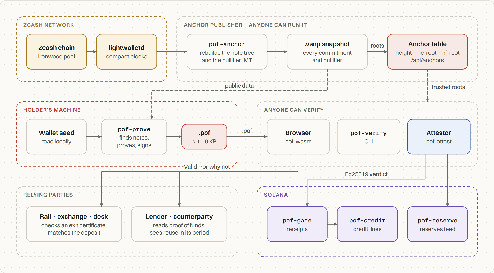
</picture>

| Component | Role | Network |
| --- | --- | --- |
| `pof-core` | The `.pof` / `.pofb` format: types, codec, checksum, statement and signing hashes | none |
| `pof-zk` | Circuit glue: embedded verifying keys, `verify_holding`, refuses repeated tags before Halo2 | none |
| `pof-verify` | The verifier and its CLI: `verify`, `verify_batch`, `exit_matches` | none |
| `pof-wasm` | `pof-verify` for the browser, about 4.6 MB, committed so CI tests exactly what ships | none |
| `pof-prove` | The holder’s library and CLI: requests, note discovery, proving, history, revocation | library: none (enforced) |
| `pof-anchor` | Rebuilds the note tree and nullifier IMT from compact blocks; snapshots; publishes anchors | lightwalletd (gRPC) |
| `pof-attest` | HTTP service: verify, sign attestations for Solana, the rail API, reserves attestations | Solana RPC, lightwalletd |
| `pof-gate` | Solana: Ed25519 attestations by introspection, k-of-n → one receipt per proof, bound to a wallet | — |
| `pof-credit` | Solana: credit lines against receipts, with freshness and refreshes | — |
| `pof-reserve` | Solana: attested reserves feed and Secure Mint | — |
| `frontend/` | Next.js 15: verifier, request builder, prover console, rail console, reserves, live demo, docs | the attestor, Solana RPC, Redis |

The circuit is the vendored voting-circuits delegation circuit with two marked changes:
1. **The threshold.** A 15th public input, `min_ballots`, and the constraint `num_ballots − min_ballots ∈ [0, 2³⁰)`.
2. **Circuit 2, for exit certificates.** A reveal flag plus five revealed nullifiers, with its own verifying key. Circuit 1’s key and parameters are byte-identical, so every earlier proof still verifies.

<details>
<summary><b>How the attestation reaches Solana</b></summary>
<br>
<picture>
  <source media="(prefers-color-scheme: dark)" srcset=".github/readme/fig-solana-tx-dark.png">
  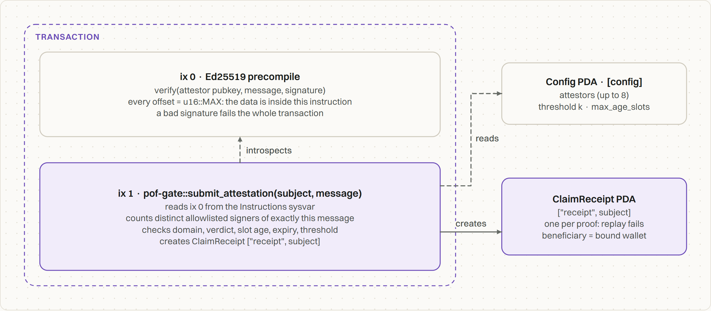
</picture>

The attestor signs a domain-separated 139-byte message (`POF-ATTEST-v1`). `pof-gate` reads the preceding Ed25519 instructions through the Instructions sysvar. It counts a signer only if every offset points inside that same instruction, the key is allowlisted and not yet counted, and the message is byte-for-byte the one submitted. A receipt is a PDA keyed by the proof id, so a replay fails at account creation.
</details>

<details>
<summary><b>A reserves batch</b></summary>
<br>
<picture>
  <source media="(prefers-color-scheme: dark)" srcset=".github/readme/fig-batch-dark.png">
  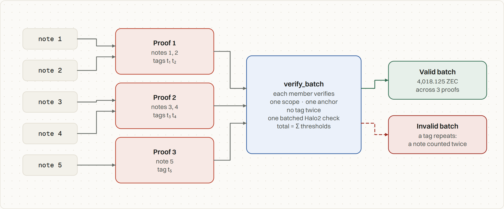
</picture>
</details>

<details>
<summary><b>The hosted deployment</b></summary>
<br>
<picture>
  <source media="(prefers-color-scheme: dark)" srcset=".github/readme/fig-deploy-dark.png">
  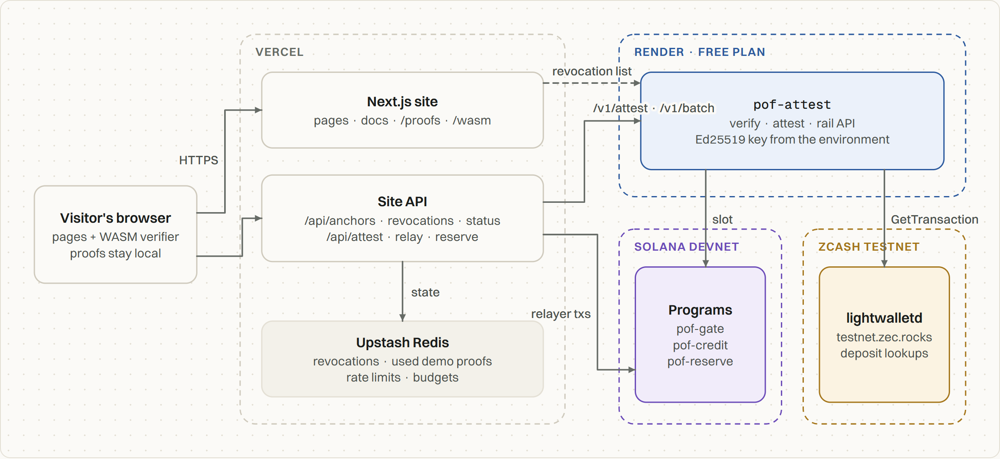
</picture>
</details>

The full architecture, with 36 diagrams, is in the [documentation](https://vouch-zcash.vercel.app/docs/architecture).

<p align="center">
  <a href="https://vouch-zcash.vercel.app/docs">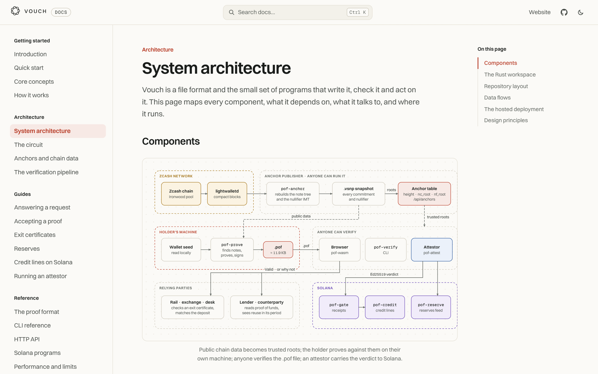</a>
</p>

## Performance

<picture>
  <source media="(prefers-color-scheme: dark)" srcset=".github/readme/fig-perf-dark.png">
  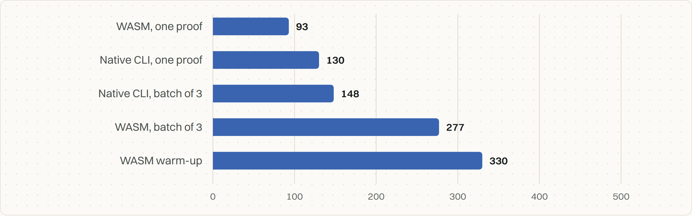
</picture>

| Measure | Value | Where measured |
| --- | --- | --- |
| Verify one proof | 93 ms (WASM) · 130 ms (native, whole process) | Node 24 · 12-core Intel Core 5 210H, WSL |
| Verify a batch of three | 148 ms native (one batched Halo2 check) · 277 ms WASM | same |
| Prove (demo ledger) | 1.4 s | same, 12 cores |
| Proof / batch size | 11.9 KB / 35.7 KB | `.pof` / `.pofb` |
| Hosted attestor, 0.1 CPU | verify 0.3 s · rail certificate 0.4 s · batch + attestation 2.0 s · deposit match 3.4 s · 33 MB RAM | Render free plan |

## Running it

The site alone (in-browser verifier, committed WASM and fixtures):

```bash
cd frontend && pnpm install && pnpm dev          # http://localhost:3000
```

Check a real testnet proof with the CLI from a [release](https://github.com/SATISH-JALAN/Vouch/releases/latest):

```bash
curl -s https://vouch-zcash.vercel.app/api/anchors     > anchors.json
curl -s https://vouch-zcash.vercel.app/api/revocations > revocations.json
curl -sO https://vouch-zcash.vercel.app/proofs/testnet-valid.pof
pof-verify check testnet-valid.pof --audience vouch:testnet-demo --anchors anchors.json --revocations revocations.json
# Valid · 1.00000000 TAZ at least · anchor 4410000 (testnet)          exit 0
```

The whole stack (a local validator with the three programs, the attestor with the demo holder, the site in LIVE mode), on Linux, macOS or WSL:

```bash
(cd backend/solana && anchor build)
./scripts/dev-stack.sh                                  # open http://localhost:3000/demo
SITE=http://localhost:3000 node scripts/e2e.mjs          # 26 end-to-end checks, in another shell
```

Prove with your own wallet (testnet shown; drop `--network testnet` for mainnet):

```bash
cd backend
cargo run --release -p pof-anchor -- scan --network testnet          # lightwalletd → snapshot + anchor
../scripts/sync-fixtures.sh                                          # publish the anchor to the site
cargo run --release -p pof-prove -- prove --request '<link from /request>' \
  --snapshot target/snapshots/testnet-<h>.vsnp --seed-file ~/seed.txt --out proof.pof
# --since <H> for "unmoved since"  ·  --exit for an exit certificate  ·  --batch-size 5 for reserves
```

Deploy: [`render.yaml`](render.yaml) runs the attestor on Render, [`scripts/deploy-devnet.sh`](scripts/deploy-devnet.sh) deploys and configures the programs, and the site goes on Vercel with root `frontend/`. Details are in [`backend/README.md`](backend/README.md) and the [docs](https://vouch-zcash.vercel.app/docs/attestor).

## Tests

None of these need a network, except the end-to-end test.

| Command | What it checks |
| --- | --- |
| `cargo test --release --workspace` (in `backend/`) | Format, every vector through the native verifier, embedded keys, IMT, the no-network invariant |
| `cargo test --release -p pof-zk --features prove --test roundtrip -- --ignored` | Real proofs: threshold, dormancy, every tamper case, one note counted five times refused |
| `cargo test --release -p voting-circuits --lib -- --ignored vouch_` | Both circuit changes: `vouch_threshold`, `vouch_reveal` |
| `cargo test -p pof-solana-tests` (in `backend/solana/`) | **26 LiteSVM tests** of the programs, including the attacks |
| `pnpm test:fixtures` · `pnpm test:wasm` (in `frontend/`) | The TypeScript codec equals the Rust encoder; the committed WASM equals native on every vector, and every result matches [the JSON Schema](frontend/public/schema/pof-v1.json) |
| `SITE=… node scripts/e2e.mjs` | **26 checks** through the live site’s API, with every breaker |

CI runs all of them except the end-to-end test, which needs a running stack.

## Repo layout

```
backend/
  crates/
    pof-core/        the .pof / .pofb format, hashes, codec
    pof-zk/          circuit glue, embedded params + verifying keys (keys/)
    pof-verify/      the verifier + pof-verify CLI          ← the single source of verdicts
    pof-prove/       the holder's library + pof-prove CLI    ← links no network client
    pof-anchor/      snapshots, root rebuild, pof-anchor CLI (lightwalletd)
    pof-attest/      the attestor: verify, attest, rail API, reserves
    pof-wasm/        the verifier for the browser
  solana/
    programs/        pof-gate · pof-credit · pof-reserve (Anchor)
    tests-rs/        26 LiteSVM tests
  vendor/            voting-circuits & co., Vouch changes marked (VOUCH-MODIFICATIONS.md)
frontend/            Next.js 15
  src/app/(site)/    verify · request · prove · rail · reserves · demo · landing
  src/app/docs/      the docs site (22 pages, search, light and dark)
  src/app/api/       anchors · revocations · status · attest · relay · reserve · docs-index
  public/wasm/       the committed WASM verifier
fixtures/            real proofs + expected verdicts, anchor tables, the demo ledger, request vectors
scripts/             build-wasm · sync-fixtures · verify-fixtures-wasm · e2e · dev-stack · deploy-devnet
render.yaml          the hosted attestor
```

## Trust model

<picture>
  <source media="(prefers-color-scheme: dark)" srcset=".github/readme/fig-trust-dark.png">
  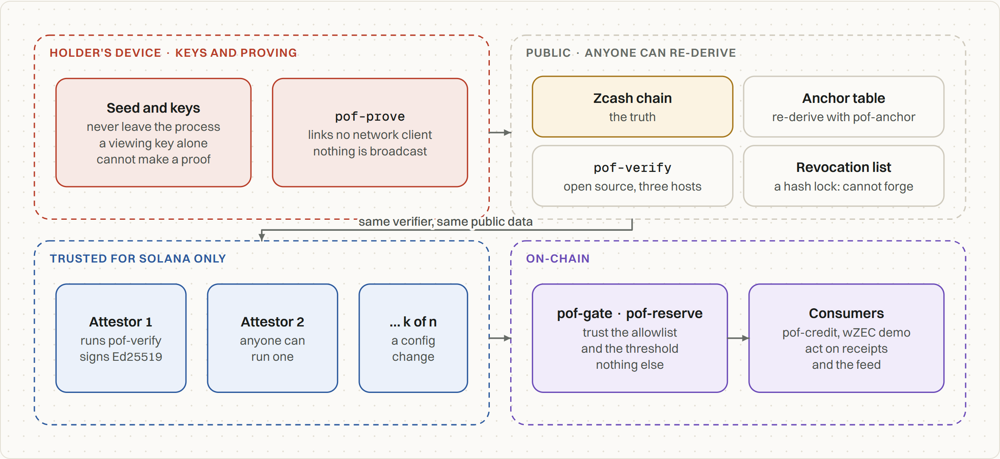
</picture>

Everything a verifier relies on is public and re-derivable, with one exception: the attestor, which only chains that can’t read Zcash need. A Solana program trusts its allowlist and threshold, nothing else. If enough allowlisted attestors lie together, the program believes them. That is the honest cost of today’s design. It is mitigated by k-of-n (2 of 3 is tested), by stateless attestors anyone can run, and by verdicts anyone can re-derive. A wrong anchor-table entry can only make honest proofs fail; it cannot make a false one pass. The full threat model, with the test that covers each attack, is in the [docs](https://vouch-zcash.vercel.app/docs/threats).

## What is not done

This is the honest list. None of it is hidden elsewhere in the repo.

**Not audited.** Not the two circuit changes, the programs or the attestor. No formal verification. Nothing here should hold mainnet money.

**There is no mainnet proof.** Every real proof is on Zcash testnet, because the build had no ZEC. The mainnet anchor at 3,493,000 is rebuilt and checked against lightwalletd, so the pipeline works on mainnet, but no mainnet note has been proven.

**The deployed programs trust one attestor.** k-of-n is implemented and tested (2 of 3 in LiteSVM), but devnet runs a single attestor with threshold 1. That attestor is trusted for Solana.

**Reuse detection is off-chain only.** Scope tags let a verifier see the same coins pledged twice. `pof-gate` still takes the v1 attestation, one receipt per proof id, so tags are not enforced on chain. The v2 attestation with tag accounts is designed, not built.

**The hosted attestor doesn’t prove.** On Render’s 0.1 CPU one proof takes about two minutes, so the demo holder is off there. `/demo` hands out 120 real single-use proofs made ahead of time. The free instance also sleeps when idle, so the first visit can wait up to a minute; the site says so and waits rather than faking it.

**The rail API’s registry lives in memory on Render**, which has no disk on the free plan, so it resets on restart. The site doesn’t proxy `/v1/certificates`; the `/rail` console runs the same checks in the browser with a local registry.

**Anchors have one publisher and no signatures.** Records are rebuilt from scratch on each scan (there is no follow mode) and are not signed, so a verifier trusts whichever table it loads. The cross-check against the NU7 poll’s own nullifier-IMT root hasn’t been done, so we don’t yet know whether our IMT root matches the ecosystem’s. Proofs verify against our anchors either way.

**Exit transactions must have no dummy spends.** No wallet builds them that way by default. The real testnet exit needed the notes consolidated first, and the first attempt is kept as a documented mismatch. Wallet integration is future work.

**The rail sees the certified notes before the deposit lands.** An exit certificate reveals the notes’ nullifiers to the rail. Holders are told to make one only when they’re ready to send. The timing between certificate and deposit is not hidden.

**One claim, five notes, 0.125 ZEC units.** Only `HoldsAtLeast`. “Received a payment” and “received at least X since H” are designed, not built. More than five notes means a batch. Thresholds are whole multiples of 0.125 ZEC, because that is how the circuit counts.

**Reserves are half of solvency.** A feed proves assets, not liabilities, and it doesn’t lock the coins. A later, lower publish lowers what can be minted, but can’t claw back what already was.

## Design choices worth one line each

**The proof is a file, not an API call.** Offline verification, a testable boundary, and a format that can outlive any implementation of it.

**One verifier, compiled three ways, checked equal in CI.** The CLI, the browser and the attestor can never disagree about a verdict, because they’re the same function.

**The verifier never trusts a field it can derive.** Both roots, the round id, the nullifier domain and the threshold are recomputed or looked up. The file carries only what can’t be.

**Reuse is visible per scope, not in a global registry.** The same notes give the same tag to one verifier in one period, and unrelated tags to everyone else, so detecting reuse never costs linkability.

**Attestors sign verdicts and hold nothing.** No user data and no funds. Each one is stateless, anyone can run one, and a program can require several.

**Demo, testnet and simulated are said wherever they apply.** A proof on the demo ledger says “demo anchor”, a testnet proof says TAZ has no value, and the demo says SIMULATED when it is.

## Credits and licence

The holding proof is the delegation circuit from Valar Group’s [voting-circuits](https://github.com/valargroup/voting-circuits), driven the way Chainapsis’s [zcash_voting](https://github.com/chainapsis/zcash_voting) drives it, over the Zakura Orchard/Ironwood crates. Vouch’s changes are listed line by line in each vendored crate’s `VOUCH-MODIFICATIONS.md` and in [THIRD-PARTY.md](THIRD-PARTY.md).

MIT OR Apache-2.0, at your option. Vendored crates keep their own licences.
